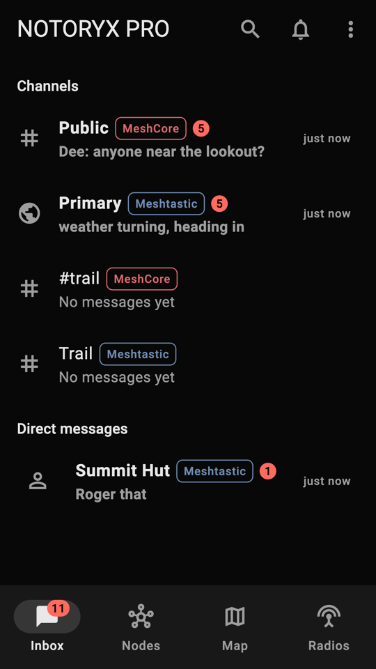
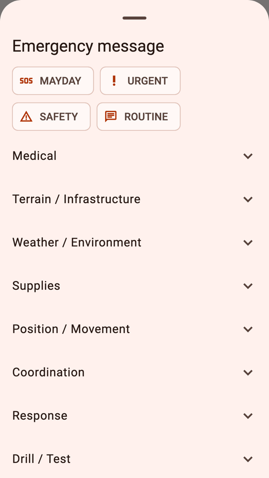
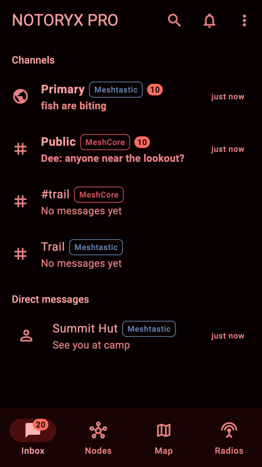

# NOTORYX PRO downloads

**One app for MeshCore and Meshtastic LoRa radios.** Part of the **NOTORYX** off-grid communications family. **No Towers. No Limits.**

This repository hosts test builds of NOTORYX PRO for Android, Mac and Windows. Get them from **[Releases](../../releases)**. There's no iPhone build yet.

<table>
  <tr>
    <td></td>
    <td></td>
    <td></td>
    <td></td>
  </tr>
  <tr>
    <td></td>
    <td></td>
    <td></td>
    <td></td>
  </tr>
</table>

Screenshots from demo mode (pretend radios, made-up places). More in the [source README](https://github.com/TheLogsAreScreaming/notoryx-PRO#readme).

## Status: test 27 out (19 November 2026)

**[0.27.0 test 27](../../releases/tag/v0.27.0-test.27)** (build 32) stops **"stale · 900 d"** on MeshCore repeaters with an unset clock, keeps **ignored** MeshCore nodes quiet on channels, and draws **range-ring labels over pins**. [Test 26](../../releases/tag/v0.26.0-test.26) released a Meshtastic radio when you leave the app with Back, and [test 25](../../releases/tag/v0.25.0-test.25) fixed a **blank map** on opening.

**What's been checked on real hardware:** test 27 on a phone with a Meshtastic and a MeshCore radio: an ignored MeshCore node's channel post was saved without a notification, synced MeshCore nodes show real last-heard times, and ring labels are readable over pins. Test 26 on a phone with a Meshtastic radio: Back releases the radio, Home keeps it connected, the map opens straight away. Test 25's blank-map fix. Test 24's stale badges, range rings and ignoring a node. Test 22's Traffic map live with a MeshCore radio.

## Install

Each test updates the previous one in place and keeps your messages.

| File | For |
|---|---|
| `NOTORYX-PRO-0.27.0-android-arm64.apk` | Most Android phones (64-bit ARM) |
| `NOTORYX-PRO-0.27.0-android.apk` | Any Android device (larger) |
| `NOTORYX-PRO-0.27.0-macos.zip` | Mac (Intel and Apple silicon), macOS 12 or later |
| `NOTORYX-PRO-0.27.0-windows-x64.zip` | Windows 10 and 11, 64-bit (never run on a real PC yet) |

- **Android:** open the APK on the phone and allow installs from your browser or file manager when asked. Signed with the NOTORYX PRO key, certificate SHA-256 `7419F685D2FBFDF533C2EE32034477531E3A414D8574320B079FC913183AFA70`.
- **Mac:** not notarized. Unzip, then right-click **NOTORYX PRO** → **Open** the first time.
- **Windows:** not code-signed. Unzip and run `notoryx_pro.exe`; if SmartScreen warns, choose **More info** → **Run anyway**.
- Each release has `SHA256SUMS.txt` to check the files.

## Progress

| Part | State |
|---|---|
| Project setup and CI | Done |
| Android, iPhone and Mac projects, permissions, blue app icon | Done |
| Bluetooth, USB (Android) and Wi-Fi links | Done |
| Automatic reconnect on Bluetooth, USB and Wi-Fi | Done |
| MeshCore protocol | Done |
| Meshtastic protocol | Done |
| One shared model for both meshes (radios, nodes, channels, messages) | Done |
| On-device database (messages keep how they arrived) | Done |
| Unified inbox, nodes, conversation and radio screens | Done |
| Messaging with delivery ticks, retries and reconnect | Done (test 1) |
| Map for both meshes with signal bars, routes and offline tiles | Done (test 2) |
| Diagnostics: packet log, radio readings, trace route, line of sight, delivery hints | Done (test 2) |
| Verified senders: QR codes, fingerprints, badges, name-clash warnings | Done (test 2) |
| MeshCore radio settings, repeater and room server admin | Done (test 3) |
| Meshtastic radio settings, remote admin and telemetry history | Done (test 3) |
| Notifications, unread counts, mute and area presets | Done (test 3) |
| Several radios at once, contacts beyond the radio's limit, channel management | Done (test 4) |
| Background connection, search, delete, export | Done (test 4) |
| MECP emergency messages | Done (test 4) |
| Other-mesh traffic, MQTT feeds, channel bridging, Spanish | Done (test 5) |
| Themes, restore, MAYDAY through mute, field reports, distress beacon, forwarding, scheduled messages, airtime savers | Done (test 6) |
| App lock, GPX and geofences, link planner, team setup, auto-replies | Done (test 7) |
| Optional encryption for saved messages | Done (test 8) |
| Windows build (untested) | Done (test 10) |
| Demo mode, About and licences, French and German, Windows notifications and USB | Done (test 11) |
| Community moderation (reports, Flagged label, appeals) | Done (test 12) |
| Password-protected backups, Meshtastic demo, Portuguese and Italian | Done (test 13) |
| Trusted nodes, network diagram, off-route alerts, route picker, nearby repeater test, trace cards, timeline, automations, day replay | Done (test 14, untested on hardware) |
| Identity key backup, repeater names, node journal, checklists, ready-made auto-replies, mesh colours | Done (test 15, untested on hardware) |
| Neon-green emergencies, mesh colours in all themes | Done (test 16, checked on a phone with a MeshCore radio) |
| Report form Send above the keyboard | Done (test 17, checked on a phone) |
| Node colours and photos, compass to a node, glass backgrounds, line of sight with terrain | Done (test 18, checked on a phone) |
| Line-of-sight numbers and lists under the navigation bar fixed | Done (test 19, checked on a phone with a MeshCore and a Meshtastic radio) |
| No heard times from radios whose clock was never set | Done (test 20, checked on a phone) |
| Map tiles that fail to download are fetched again | Done (test 21, untested on hardware) |
| Live Traffic map, map toolbar, custom Meshtastic radio settings | Done (test 22, checked on a phone with a MeshCore and a Meshtastic radio) |
| No false "No internet" on the map, blank tiles refill, telemetry "Never" | Done (test 23, checked on a phone) |
| Stale-node badge, map range rings, ignored nodes | Done (test 24, mostly checked on a phone with a Meshtastic radio) |
| No blank map on opening; sane stale ages; ring labels clear of controls | Done (test 25, map fix checked on a phone) |
| Bluetooth released when leaving with Back; ring labels off node pins | Done (test 26, checked on a phone; innermost label can still touch a pin) |
| MeshCore last-heard from your radio, ignored MeshCore channel posts silenced, ring labels over pins | Done (test 27, checked on a phone) |
| iPhone build, Google Play, App Store | Not started (needs Apple and Play developer accounts) |

## Installs alongside other NOTORYX apps

| | App ID |
|---|---|
| Android | `com.bastionmesh.notoryx_pro` |
| iPhone / Mac | `com.bastionmesh.notoryxPro` |

## License

NOTORYX PRO is free software under the GNU General Public License v3.0. Source: [notoryx-PRO](https://github.com/TheLogsAreScreaming/notoryx-PRO).
