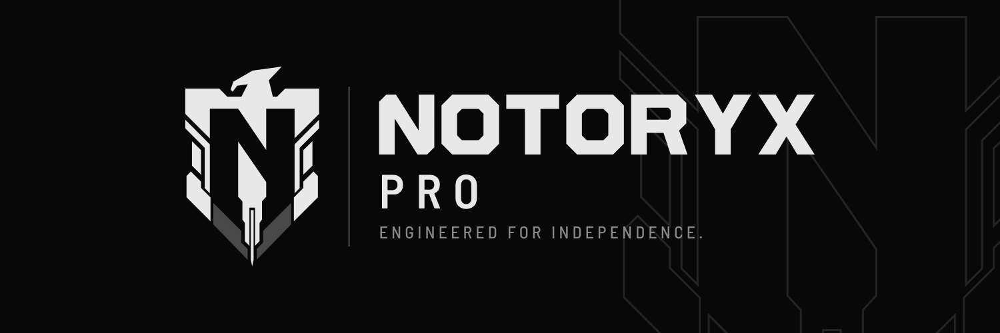
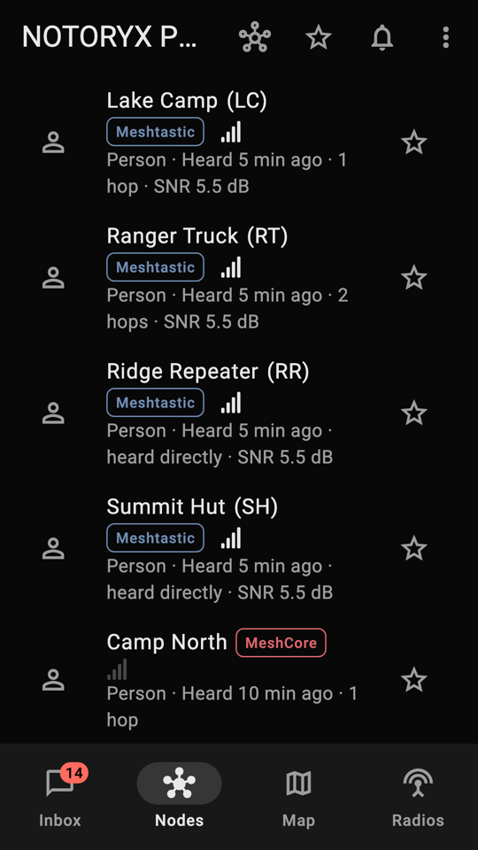
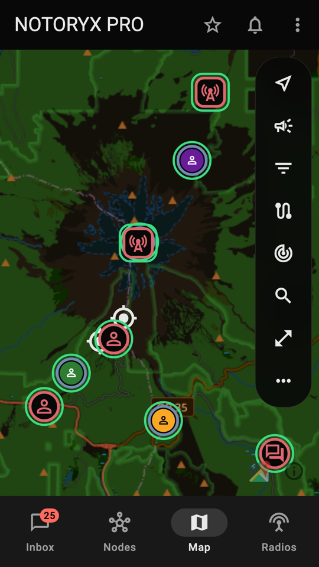
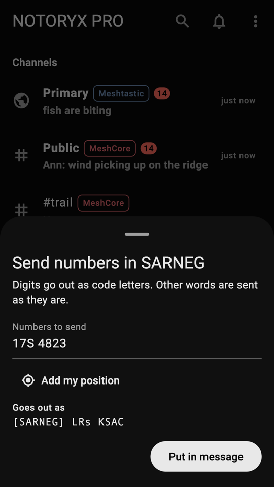
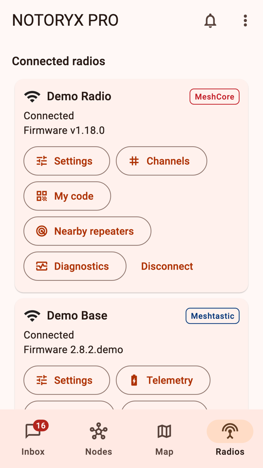
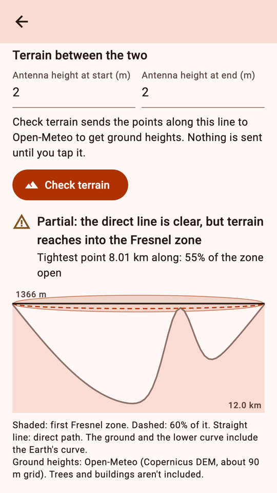
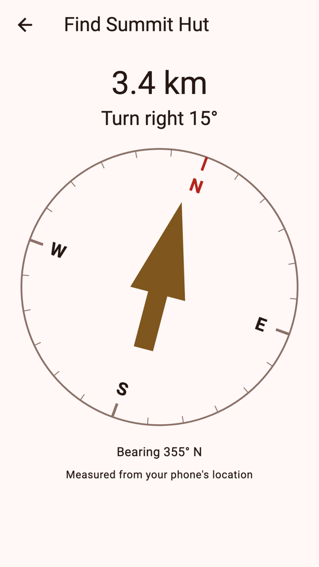
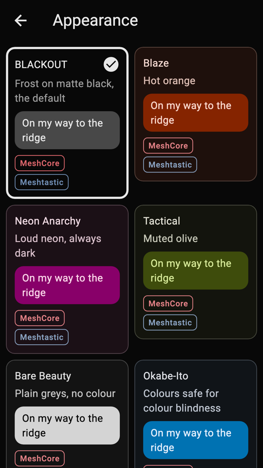

# NOTORYX PRO downloads

**One app for MeshCore and Meshtastic LoRa radios.** Part of the **NOTORYX** off-grid communications family. **No Towers. No Limits.**

Connect a MeshCore companion and a Meshtastic node at the same time, and chat, map and manage both from one inbox, one map and one node list. This repository hosts test builds of NOTORYX PRO for Android, Mac and Windows. Get them from **[Releases](../../releases)**. There's no iPhone build yet.

<table>
  <tr>
    <td></td>
    <td></td>
    <td></td>
    <td></td>
  </tr>
  <tr>
    <td></td>
    <td></td>
    <td></td>
    <td></td>
  </tr>
</table>

Screenshots from demo mode (pretend radios, made-up names and places) in the default **BLACKOUT** look.

## Status: test 38 out (26 November 2026)

**[0.38.0 test 38](../../releases/tag/v0.38.0-test.38)** (build 43) clears copied SARNEG text exactly one minute after you copy it, if your phone allows exact alarms for PRO. **SARNEG → Options** shows whether it does, and a tap opens the Android page to allow it. Checked on a phone with exact alarms not allowed: with the app killed, nothing was left to paste after two minutes. The exact path isn't checked yet.

[Test 37](../../releases/tag/v0.37.0-test.37) (build 42) makes sure SARNEG text you copy is cleared from the clipboard even if your phone closes the app before the minute is up (Samsung phones do this): the clear is now scheduled with Android itself. Checked on a phone with the app killed: after about two minutes another app had nothing to paste.

[Test 36](../../releases/tag/v0.36.0-test.36) adds a **Privacy page** (what can leave your phone, and whether each is on), a warning when a sender's name only **looks like** a node you trust, a **Support report** for bug reports with every name, ID, key and address removed, and report status for community moderation. It also fixes SARNEG copied text staying on the clipboard after you switch apps, the grey demo map, and several MeshCore issues (large contact lists, long channel posts, negative transmit power, contacts-full warning). On a phone: the Privacy page, the Support report, the real demo map and the SARNEG clipboard clear were checked; nothing has been tried over the air yet.

[Test 35](../../releases/tag/v0.35.0-test.35) speaks **18 languages** (added Bulgarian, Hungarian, Japanese, Korean, Dutch, Polish, Russian, Slovak, Slovenian, Swedish, Ukrainian and Chinese; all but English machine-written) and adds more **SARNEG** options: keep the grid zone in clear, send without the marker, expiry and "delete all words after a day", a secret SARDOT reference point with a map button, and number and letter of the day. The SARNEG format is unchanged. Test 35 hasn't been tried on a phone or radio yet.

[Test 34](../../releases/tag/v0.34.0-test.34) encrypts saved messages **by default** on Android phones and Macs (the first start converts your existing messages, keeping the old file if anything fails), and adds **coverage mapping** (MeshCore: record where your radio hears packets; sharing with the NOTORYX coverage map is off until you agree), **follow a node for 15 minutes** with its trail, **sensor history and alerts** for MeshCore nodes, **repeater status and neighbour signal history**, and a warning when a MeshCore radio's channels were changed elsewhere. On a phone, its first start encrypted the saved messages with none lost.

[Test 33](../../releases/tag/v0.33.0-test.33) made the demo open with a short made-up history. [Test 32](../../releases/tag/v0.32.0-test.32) brought the **BLACKOUT** look: the steel eagle-N app icon and BLACKOUT (frost on matte black) as the default theme.

[Tests 29 to 31](../../releases/tag/v0.31.0-test.31) added **SARNEG code words**: grids, frequencies and times go out as letters from a 10-letter word your team agrees on (or a **Random word**), and a received `[SARNEG]` message decodes with a tap. The word hides itself after 30 seconds, copied SARNEG text leaves the clipboard after a minute, well-known words get a warning, and screenshots are blocked on SARNEG screens. It keeps numbers away from a casual listener; it isn't encryption. [What SARNEG is and why we added it](https://meshmayhem.org/notoryx/#sarneg).

**What's been checked on real hardware:** test 32 on a phone: the BLACKOUT icon and look, the SARNEG weak-word warning, Random word, the 30-second hide and 1-minute clear, and black screenshots on the SARNEG sheet and decoded lines. Tests 29 to 31 on a phone: the SARNEG word check, Show/Hide, share QR, coding and decoding on the demo radio (not yet over the air), and a black screenshot on SARNEG screens. Test 28: the old "stale · 900 d" MeshCore dates are gone. Test 27 with a Meshtastic and a MeshCore radio: an ignored MeshCore node's channel post was saved without a notification, synced MeshCore nodes show real last-heard times, ring labels are readable over pins. Test 26: Back releases the radio, Home keeps it connected.

## What it does

- **Both meshes, one app:** up to four MeshCore and Meshtastic radios at once over Bluetooth, USB (Android and Windows) or Wi-Fi, with automatic reconnect. **Demo mode** lets you try it without a radio.
- **Messaging:** one inbox, delivery ticks and retries, channels shared by QR code, forwarding, scheduled messages, search, export, auto-replies and SARNEG code words.
- **Map:** both meshes on one map with signal bars, offline tiles you've viewed, a live Traffic map, range rings, stale-node badges, places and GPX, compass to a node and line of sight with terrain.
- **Diagnostics:** packet log, noise floor, trace route with trace cards, nearby repeater test, network diagram and delivery hints.
- **Trust and safety:** verified senders, trusted nodes, ignore a node, MECP emergency messages, MAYDAY through mute, distress beacon, SALUTE and 9-Line reports, checklists.
- **Radio admin:** MeshCore and Meshtastic radio settings, repeater and room server admin, remote admin over the mesh.
- **Your look, your data:** seven looks, glass backgrounds, node colours and photos, app lock, messages encrypted by default on phones and Macs, password-protected backups. 18 languages.

## Install

Each test updates the previous one in place and keeps your messages.

| File | For |
|---|---|
| `NOTORYX-PRO-0.38.0-android-arm64.apk` | Most Android phones (64-bit ARM) |
| `NOTORYX-PRO-0.38.0-android.apk` | Any Android device (larger) |
| `NOTORYX-PRO-0.38.0-macos.zip` | Mac (Intel and Apple silicon), macOS 12 or later |
| `NOTORYX-PRO-0.38.0-windows-x64.zip` | Windows 10 and 11, 64-bit (never run on a real PC yet) |

- **Android:** open the APK on the phone and allow installs from your browser or file manager when asked. Signed with the NOTORYX PRO key, certificate SHA-256 `7419F685D2FBFDF533C2EE32034477531E3A414D8574320B079FC913183AFA70`.
- **Mac:** not notarized. Unzip, then right-click **NOTORYX PRO** → **Open** the first time.
- **Windows:** not code-signed. Unzip and run `notoryx_pro.exe`; if SmartScreen warns, choose **More info** → **Run anyway**.
- Each release has `SHA256SUMS.txt` to check the files.

## Progress

| Part | State |
|---|---|
| Project setup and CI | Done |
| Android, iPhone and Mac projects, permissions, app icon | Done |
| Bluetooth, USB (Android) and Wi-Fi links | Done |
| Automatic reconnect on Bluetooth, USB and Wi-Fi | Done |
| MeshCore protocol | Done |
| Meshtastic protocol | Done |
| One shared model for both meshes (radios, nodes, channels, messages) | Done |
| On-device database (messages keep how they arrived) | Done |
| Unified inbox, nodes, conversation and radio screens | Done |
| Messaging with delivery ticks, retries and reconnect | Done (test 1) |
| Map for both meshes with signal bars, routes and offline tiles | Done (test 2) |
| Diagnostics: packet log, radio readings, trace route, line of sight, delivery hints | Done (test 2) |
| Verified senders: QR codes, fingerprints, badges, name-clash warnings | Done (test 2) |
| MeshCore radio settings, repeater and room server admin | Done (test 3) |
| Meshtastic radio settings, remote admin and telemetry history | Done (test 3) |
| Notifications, unread counts, mute and area presets | Done (test 3) |
| Several radios at once, contacts beyond the radio's limit, channel management | Done (test 4) |
| Background connection, search, delete, export | Done (test 4) |
| MECP emergency messages | Done (test 4) |
| Other-mesh traffic, MQTT feeds, channel bridging, Spanish | Done (test 5) |
| Themes, restore, MAYDAY through mute, field reports, distress beacon, forwarding, scheduled messages, airtime savers | Done (test 6) |
| App lock, GPX and geofences, link planner, team setup, auto-replies | Done (test 7) |
| Optional encryption for saved messages | Done (test 8) |
| Windows build (untested) | Done (test 10) |
| Demo mode, About and licences, French and German, Windows notifications and USB | Done (test 11) |
| Community moderation (reports, Flagged label, appeals) | Done (test 12) |
| Password-protected backups, Meshtastic demo, Portuguese and Italian | Done (test 13) |
| Trusted nodes, network diagram, off-route alerts, route picker, nearby repeater test, trace cards, timeline, automations, day replay | Done (test 14, untested on hardware) |
| Identity key backup, repeater names, node journal, checklists, ready-made auto-replies, mesh colours | Done (test 15, untested on hardware) |
| Neon-green emergencies, mesh colours in all themes | Done (test 16, checked on a phone with a MeshCore radio) |
| Report form Send above the keyboard | Done (test 17, checked on a phone) |
| Node colours and photos, compass to a node, glass backgrounds, line of sight with terrain | Done (test 18, checked on a phone) |
| Line-of-sight numbers and lists under the navigation bar fixed | Done (test 19, checked on a phone with a MeshCore and a Meshtastic radio) |
| No heard times from radios whose clock was never set | Done (test 20, checked on a phone) |
| Map tiles that fail to download are fetched again | Done (test 21, untested on hardware) |
| Live Traffic map, map toolbar, custom Meshtastic radio settings | Done (test 22, checked on a phone with a MeshCore and a Meshtastic radio) |
| No false "No internet" on the map, blank tiles refill, telemetry "Never" | Done (test 23, checked on a phone) |
| Stale-node badge, map range rings, ignored nodes | Done (test 24, mostly checked on a phone with a Meshtastic radio) |
| No blank map on opening; sane stale ages; ring labels clear of controls | Done (test 25, map fix checked on a phone) |
| Bluetooth released when leaving with Back; ring labels off node pins | Done (test 26, checked on a phone; innermost label can still touch a pin) |
| MeshCore last-heard from your radio, ignored MeshCore channel posts silenced, ring labels over pins | Done (test 27, checked on a phone) |
| Old wrong MeshCore last-heard dates cleared | Done (test 28, checked on a phone) |
| SARNEG code words for numbers in messages | Done (test 29, checked on a phone, not yet over the air) |
| SARNEG: screen reader says "Code word hidden" while masked | Done (test 30, checked on a phone) |
| SARNEG: auto-clear, Random word, weak-word warning, screenshot block | Done (test 31, screenshot block checked on a phone) |
| BLACKOUT look as the default and the new app icon | Done (test 32, checked on a phone) |
| Demo opens with a made-up history | Done (test 33, untested on hardware) |
| Encrypted by default, coverage mapping, follow a node, sensor and repeater history, channel mismatch warning | Done (test 34, encryption on first start checked on a phone) |
| 18 languages and more SARNEG options (zone in clear, no marker, expiry, SARDOT, number of the day) | Done (test 35) |
| Privacy page, look-alike name warning, support report, SARNEG clipboard fix, MeshCore fixes | Done (test 36, Privacy page, support report and clipboard fix checked on a phone) |
| SARNEG clipboard cleared even when the phone closes the app | Done (test 37, checked on a phone with the app killed) |
| iPhone build, Google Play, App Store | Not started (needs Apple and Play developer accounts) |

## Installs alongside other NOTORYX apps

| | App ID |
|---|---|
| Android | `com.bastionmesh.notoryx_pro` |
| iPhone / Mac | `com.bastionmesh.notoryxPro` |

## License

NOTORYX PRO is free software under the GNU General Public License v3.0. To get the source code for any build, [open an issue](../../issues/new) here.

## Problems or ideas

Open an issue in this repository with your phone or computer model, the app version (from the About screen) and your radio model and firmware.
